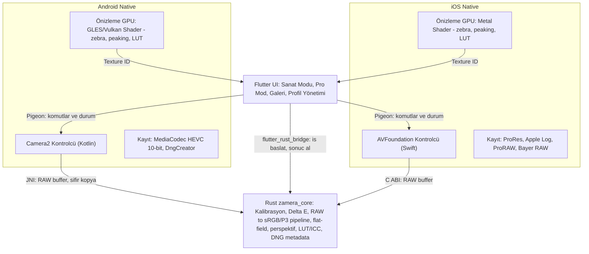

# Zamera — Rapor v2: Denetim, Düzeltmeler ve Revize Mimari

> Kapsam: v1 raporunun ([zamera_arastirma_ve_mimari_raporu.md](file:///C:/Users/theak/.gemini/antigravity/brain/9d7b95f2-176e-444e-81e6-0a0e4a4da58e/zamera_arastirma_ve_mimari_raporu.md)) talepleri karşılayıp karşılamadığını denetler. Yeni gereksinim de rapora işlendi: **Sanat Modu ve Pro Mod iki platformda da** çalışacak.
> Repo varlığı ve lisansları GitHub API'den **6 Kasım 2026** tarihinde canlı olarak doğrulandı.

---

## 0. Sonuç: v1 Talepleri Karşılıyor mu?

**Kısmen.** Yön (native kamera + ortak çekirdek + Flutter UI) doğruydu. Ancak raporda **asıl problemi ("gerçek renk") çözmeyen bir renk yöntemi**, **lisans açısından kullanılamayacak kütüphane önerileri**, **teknik olarak çalışmayacak bir önizleme tasarımı** ve **projeyi durdurabilecek riskler (Windows'ta iOS derlenemez, Xiaomi API kısıtları)** vardı. Ayrıca v1, platformları birbirine bağlıyordu (Sanat Modu = Android, Pro Mod = iOS). Yeni gereksinim bunun tersini, yani iki platformda da iki modun olmasını istiyor.

| # | v1'deki iddia / eksik | Önem | Düzeltme |
|---|---|---|---|
| 1 | Kağıt beyazına dokunup beyaz dengesi almak "gerçek renk" verir | 🔴 Kritik | Yanlış. Çizim kağıdı nötr değildir (krem tonlu veya optik beyazlatıcılı/mavimsi olabilir). Kağıdı nötrlemek, eserin rengini **bozar**. Doğru yol: **gri kart / ColorChecker** ile beyaz dengesi ve **renk profili kalibrasyonu**, ardından ΔE2000 ölçümü (§2). |
| 2 | ColorChecker "opsiyonel" diye geçiyor | 🔴 Kritik | Gerçek renk için **zorunlu çekirdek** bu. Telefonun DNG içine yazdığı `ColorMatrix`/`ForwardMatrix` genel amaçlıdır. Sensör ile pigment arasındaki metamerizm sadece ölçüme dayalı profille küçültülebilir. |
| 3 | Ekran (display) ve renk yönetimi hiç konuşulmamış | 🔴 Kritik | Xiaomi ekranı varsayılan olarak "Canlı/Vivid" modda doymuş gösterir. ICC etiketi olmayan P3 dosya sRGB sanılır. Sorunun bir kısmı **çekimde değil, gösterimde** olabilir (§1). |
| 4 | Pipeline'da ton eğrisi hiç yok ("S-curve yok") | 🟠 Yüksek | Doğrusal veri, OETF (sRGB transfer fonksiyonu) uygulanmadan koyu görünür. Lens gölgelenmesi (vinyet) düzeltmesi ve kanal bazlı siyah seviyesi de eksikti. Doğru sıra §2.3'te. |
| 5 | Android'de `NOISE_REDUCTION_OFF`/`EDGE_OFF` ile "sıfır ISP" | 🟡 Orta | Bu bayraklar RAW'u değil, sadece işlenmiş YUV/JPEG'i etkiler. `RAW_SENSOR` zaten işlenmemiş gelir. |
| 6 | Zebra, peaking ve histogram Flutter `FragmentProgram` ile, `Texture` üzerinde yapılır | 🔴 Kritik | **Çalışmaz.** Flutter shader'ı `Texture` widget'ındaki kamera karesini örnekleyemez. Bu araçlar **native GPU'da** (Metal / OpenGL ES-Vulkan) çizilip Flutter'a hazır texture olarak verilmeli. |
| 7 | Piksel verisi Dart üzerinden Rust'a gidiyor (diyagram belirsiz) | 🟠 Yüksek | 50–100 MB'lık RAW kareler **asla Dart'a girmemeli**. Akış: Kotlin → JNI → Rust, Swift → C ABI → Rust. Dart ↔ Rust (`flutter_rust_bridge`) sadece komut ve sonuç taşır. |
| 8 | "120 FPS vizör", "milisaniyede 50MP işleme", "~800 satır native", "3 haftalık plan" | 🟠 Yüksek | Gerçekçi değil. Kamera önizlemesi sensör hızındadır (30/60 fps). 50MP demosaic CPU'da yüzlerce ms ile saniyeler arası sürer. Native katman binlerce satır olur. Gerçekçi süre 4–6 ay (§6). |
| 9 | iPhone'da "48 MP Pure Bayer RAW 12/14-bit" | 🔴 Kritik | Yanlış. AVFoundation tek karelik **Bayer RAW'ı 12 MP** verir (quad-Bayer). 48 MP sadece **ProRAW** ile alınır, o da çok kareli Apple işlemesinden geçer (Halide Process Zero da bu yüzden 12 MP). |
| 10 | "Lenslere müdahale": diyafram yok, ND yok | 🟠 Yüksek | iPhone lenslerinde **diyafram sabittir**. Gündüz 180° shutter kullanmak **fiziksel ND filtre** gerektirir. Müdahale edilebilenler: fiziksel lens seçimi, manuel odak (`lensPosition`), ISO/shutter, WB, stabilizasyon modu, format. |
| 11 | Xiaomi'de fiziksel lens ve RAW erişimi garanti gibi sunulmuş | 🔴 Kritik | HyperOS, tele/ultra geniş lensleri ve bunların RAW akışını 3. parti uygulamalardan **sıklıkla gizler**. 50MP tam çözünürlük RAW, `ULTRA_HIGH_RESOLUTION_SENSOR` yeteneğine bağlıdır. **Faz 0'da cihaz üzerinde ölçülmeli.** |
| 12 | Lisanslar hiç incelenmemiş | 🔴 Kritik | `dng-rs` **lisanssız** (kullanılamaz). `zenraw` AGPL-3.0. `motioncam`, `PhotonCamera`, Open Camera GPL'dir (kod kopyalanırsa uygulamanın tamamı GPL olur ve App Store ile çatışır). Tablo §5'te. |
| 13 | `f0enix/motioncam` "en güçlü referans" | 🟡 Orta | Repo **2021'den beri güncellenmiyor** (85★, GPL-3.0). `OpenMotionFX/OpenCamera` 3★, olgun değil. |
| 14 | Kullanıcı Windows'ta, iOS derleme yolu yok | 🔴 Kritik | iOS derlemesi için **macOS + Xcode** şart: kendi Mac'iniz veya CI (GitHub Actions macOS / Codemagic). Cihaza kalıcı kurulum için **Apple Developer hesabı (99 \$/yıl)** gerekir. Ücretsiz hesapla imza 7 günde bir yenilenir. |
| 15 | Android Pro video (Log/10-bit) ve ses hiç yok | 🟠 Yüksek | Android'de standart Log API'si yok. Seçenekler: **HLG10 10-bit HEVC** (`DynamicRangeProfiles`) ve düz ton eğrisi. Düğün için ses seviye göstergesi ve harici mikrofon şart. |
| 16 | Bugün ücretsiz çözüm listesinde Lightroom yok | 🟡 Orta | **Adobe Lightroom Mobile kamerası** iki platformda da ücretsiz DNG ve Pro mod sunar. Sanat Modu testinde hemen kullanılabilir. |

---

## 1. Kod Yazmadan Önce: Sorunun Kaynağını Teşhis Et (1 gün, ücretsiz)

"Renkler değişiyor" şikâyetinin üç olası kaynağı var. Hangisinin baskın olduğunu bilmeden uygulama yazmak riskli:

1. **Gösterim (Ekran):** Xiaomi'de `Ayarlar → Ekran → Renk şeması`'ndan **Orijinal renk / sRGB** seçin. iPhone'da True Tone ve Night Shift kapalı olsun. Dosya başka bir ekranda farklı mı görünüyor?
2. **Işık:** Karışık ışık (pencere + sarı ampul) hiçbir kamerada doğru renk vermez. **5000K, CRI ≥ 95** iki lamba, 45° açıyla. Parlak yüzeyler (grafit, marker, yağlı boya) için opsiyonel çapraz polarizasyon.
3. **Çekim (ISP):** Aynı çizimi aynı ışıkta (a) stok kamera, (b) Xiaomi Pro mod RAW + sabit WB, (c) Lightroom DNG ile çekin. Kadraja bir **gri kart** (≈150–300 TL) koyun.

> [!IMPORTANT]
> Bu test sorunu büyük ölçüde çözerse, Zamera'nın Sanat Modu'nun asıl değeri **iş akışı otomasyonu** olur: kalibrasyon, perspektif düzeltme, düzgün aydınlatma, doğru etiketli dışa aktarım.

---

## 2. Sanat Modu (Gerçek Renk) — Düzeltilmiş Bilimsel Yöntem (iOS + Android)

### 2.1 Hedef ve ölçüt
- Hedef: Ortalama **ΔE2000 ≤ 2–3** (müze dijitalleştirme kılavuzları FADGI/Metamorfoze ile aynı mantık; telefon için gerçekçi hedef).
- Uygulama her kalibrasyondan sonra ΔE raporu gösterir. "Gerçek renk" bir iddia olarak değil, **ölçülen bir sayı** olarak sunulur.

### 2.2 Kalibrasyon akışı (bir ışık düzeni için bir kez)
1. **ColorChecker** (24 yamalı; ucuz klonları ile başlanabilir) aynı ışıkta RAW olarak çekilir.
2. Uygulama 4 köşe işaretiyle yamaları bulur (ileride otomatik tespit).
3. Yamaların lineer kamera RGB değerleri ile referans Lab/XYZ değerleri arasında **3×3 matris** en küçük kareler yöntemiyle oturtulur (beyazı koruyan kısıtla). Gerekirse ince ayar için **3D LUT** eklenir.
4. Sonuç bir **Profil** olarak saklanır (cihaz + lens + ışık düzeni). DNG içine `ColorMatrix`/`ForwardMatrix` olarak da yazılabilir.
5. **Flat-field:** Boş, düzgün bir kağıt çekilir. Kanal bazında ortalamasına normalize edilerek sadece **uzamsal ışık düzensizliği** düzeltilir (renk dengesini değiştirmez).

### 2.3 Doğru işleme sırası (Rust çekirdek, iki platformda aynı)
1. Kanal bazlı siyah seviyesi çıkarma ve beyaz seviyeye normalize etme
2. Lens gölgelenmesi düzeltmesi (Android `LENS_SHADING_MAP`) ve flat-field
3. Beyaz dengesi: **gri kart / ColorChecker nötr yamalarından** (kağıttan değil)
4. Demosaic
5. Kalibre matris ile Kamera RGB → XYZ (D50)
6. Bradford adaptasyonu ile D50 → D65, ardından lineer sRGB veya Display P3
7. (Opsiyonel) 3D LUT ince ayarı
8. **OETF** (sRGB/P3 transfer eğrisi). Yaratıcı kontrast eğrisi yok.
9. **16-bit TIFF/PNG + gömülü ICC** (arşiv) ve **sRGB JPEG** (paylaşım). Orijinal DNG her zaman saklanır.

$$
\mathbf{RGB}_{\text{çıkış}} = \text{OETF}\Big(M_{\text{XYZ}\to\text{hedef}} \cdot M_{\text{Bradford}} \cdot M_{\text{kalibre}} \cdot \operatorname{diag}(\mathbf{g}_{\text{WB}}) \cdot \frac{\mathbf{raw} - \mathbf{b}}{w - \mathbf{b}} \Big)
$$

### 2.4 Platforma göre RAW kaynağı
| | iPhone 17 Pro Max | Xiaomi 17 Pro Max |
|---|---|---|
| Sanat için önerilen | **Bayer RAW, 12 MP, tek kare** (çok kare/AI işleme yok). A4 için ≈ 345 ppi, yeterli. | `RAW_SENSOR`, ana kamera (muhtemelen 12.5 MP binned) |
| Yüksek çözünürlük | ProRAW 48 MP (Apple işlemeli, yine de lineer DNG) | 50 MP, `SENSOR_PIXEL_MODE_MAXIMUM_RESOLUTION` destekleniyorsa (**Faz 0**) |
| DNG yazımı | `AVCapturePhoto.fileDataRepresentation()` | `DngCreator` |
| Ekstra | Perspektif düzeltme (4 köşe), tripod/uzaktan deklanşör, pozlama kilidi (beyaz kağıt ≈ L* 95, patlamasın) | Aynısı |

---

## 3. Pro Mod — İki Platform için Özellik Matrisi

✅ mümkün · ⚠️ cihaz/API doğrulaması gerekli · ❌ platform izin vermiyor

| Özellik | iPhone 17 Pro Max (AVFoundation) | Xiaomi 17 Pro Max (Camera2) |
|---|---|---|
| Manuel ISO / Shutter | ✅ `setExposureModeCustom` | ✅ `MANUAL_SENSOR` (⚠️ yetenek kontrolü) |
| Manuel WB (Kelvin/Tint) | ✅ `deviceWhiteBalanceGains` | ✅ `COLOR_CORRECTION_GAINS` (⚠️ `MANUAL_POST_PROCESSING`) |
| Manuel odak / focus pull | ✅ `setFocusModeLocked(lensPosition:)` | ✅ `LENS_FOCUS_DISTANCE` |
| **Fiziksel lens kilidi** (otomatik geçiş yok) | ✅ 13 / 24 / 100 mm ayrı cihazlar | ⚠️ HyperOS tele/UW'yu gizleyebilir |
| Diyafram | ❌ Sabit | ⚠️ `LENS_INFO_AVAILABLE_APERTURES` kontrol edilecek |
| RAW fotoğraf | ✅ Bayer 12 MP / ProRAW 48 MP | ✅ Ana kamera · ⚠️ diğer lensler |
| Log video | ✅ Apple Log · ⚠️ Apple Log 2 3. parti API'si doğrulanacak | ❌ standart Log yok → **HLG10 10-bit HEVC** + düz eğri |
| ProRes 422 HQ | ✅ (yüksek fps için harici SSD) | ❌ → yüksek bitrate HEVC 10-bit |
| RAW video | ⚠️ ProRes RAW (Blackmagic yapabiliyor, API erişimi doğrulanacak) | ⚠️ `RAW_SENSOR` DNG dizisi (MotionCam yöntemi, yüksek bant genişliği) |
| Open Gate (4:3 tam sensör) | ⚠️ format listesinden doğrulanacak | ⚠️ |
| 180° shutter kilidi, sabit fps | ✅ | ✅ |
| Stabilizasyon modu seçimi | ✅ off/standard/cinematic | ✅ `VIDEO_STABILIZATION_MODE` / OIS |
| Zebra, peaking, false color, histogram, waveform | ✅ Metal shader | ✅ GLES/Vulkan shader |
| 3D LUT önizleme (Log izleme) | ✅ | ✅ |
| Ses seviye göstergesi, harici USB-C mikrofon | ✅ | ✅ |
| Timecode / Genlock | ⚠️ | ❌ |
| Harici SSD'ye kayıt | ✅ | ⚠️ SAF üzerinden, yavaş olabilir |

> [!WARNING]
> Pro **video** tarafında Blackmagic Camera (ücretsiz) iPhone'da zaten çok güçlü. Önerim: Zamera'nın iOS Pro Video modu MVP'de **temel düzeyde** kalsın (Log + ProRes + kilitler + zebra/peaking + ses). Asıl yatırım, rakipsiz olan **Sanat Modu + Pro Foto** ve iki platformda **aynı deneyim** olsun.

---

## 4. Revize Mimari

**Karar değişmedi, ama sınırlar düzeltildi:** Flutter (UI) + **Native kamera ve GPU motoru** (Kotlin/Swift + shader) + **Rust renk çekirdeği** (sadece gerçek zamanlı olmayan işler).

### Katman gerekçeleri
- **Flutter:** Tek UI kodu, iki platformda aynı Sanat ve Pro deneyimi. Kamera karesi Flutter'a yalnızca **native tarafta işlenmiş texture** olarak gelir.
- **Native:** Donanım API'leri (Camera2, AVFoundation) ve gerçek zamanlı shader'lar zorunlu olarak burada yazılır. Shader mantığı küçüktür, iki dilde (GLSL/Metal) yazmak kabul edilebilir.
- **Rust:** Renk bilimi iki platformda **birebir aynı sonucu** vermeli. Aynı DNG'den aynı profil ile aynı piksel çıkmalı. Tek kaynak bu tutarlılığı garanti eder ve birim testlerle doğrulanabilir.
- **Alternatifler:** C++ çekirdek (OpenCV `mcc` ile otomatik ColorChecker tespiti ve LibRaw gibi daha olgun kütüphaneler) geçerli bir alternatif. Kotlin Multiplatform da düşünülebilir, ama UI paylaşımında Flutter daha olgun. Saf Rust UI ve hazır Flutter kamera paketleri (`camera`, `camera_awesome`) v1'deki gerekçelerle **elenmiş durumda**.

---

## 5. Açık Kaynak Envanteri — Doğrulanmış Lisanslar (06.11.2026)

| Repo | Lisans | ★ | Son push | Zamera'da kullanım |
|---|---|---|---|---|
| `fzyzcjy/flutter_rust_bridge` | MIT | 5.5k | 2026-11 | ✅ Bağımlılık |
| `ybouane/flashraw` | Apache-2.0 | 119 | 2026-10 | ✅ RAW/DNG okuma (DNG'yi yeniden işlerken) |
| `Hexilee/rsraw` (LibRaw) | MIT (+LibRaw LGPL/CDDL) | 21 | 2026-03 | ⚠️ LGPL dinamik linkleme şartı |
| `pedrocr/rawloader`, `dnglab/dnglab`, `darktable-org/rawspeed` | LGPL-2.1 | 382 / 711 / 462 | güncel | ⚠️ Dinamik linkleme şartı. iOS'ta pratik değil, referans olarak okunmalı |
| `apertus-open-source-cinema/dng-rs` | **Lisans yok** | 28 | 2026-07 | ❌ Kullanılamaz (v1 önermişti) |
| `imazen/zenraw` | **AGPL-3.0** | 4 | 2026-11 | ❌ |
| `eszdman/PhotonCamera` | GPL-3.0 | 1.1k | 2026-10 | 📖 Sadece algoritma referansı, kod kopyalanmaz |
| `f0enix/motioncam` | GPL-3.0 | 85 | **2021** | 📖 Eski. RAW video yöntemi için referans |
| `KillerInk/FreeDcam` | GPL-2.0 | 373 | 2026-07 | 📖 Camera2 yetenek keşfi referansı |
| `danopdev/SimpleRawCamera`, `tribixbite/CustomCamera` | MIT | 19 / 11 | güncel | ✅ Camera2 manuel kontrol örnekleri (küçük projeler) |
| `k-arindam/SwiftUICamera`, `NextLevel/NextLevel` | MIT | 23 / 2.3k | 2025 / 2026 | ✅ AVFoundation örnekleri |
| Apple AVCam örnek kodu | Apple Sample Code License | – | – | ✅ iOS iskeleti |
| `frolovilya/kamepa-app`, `robo-fish/ManualCamera` | **Lisans yok** | 8 / 7 | eski | ❌ Kod kullanılamaz |
| `OpenMotionFX/OpenCamera` | MIT | 3 | 2026-07 | ⚠️ Olgun değil |

> [!CAUTION]
> GPL lisanslı bir koddan tek bir dosya bile kopyalamak, Zamera'nın tamamını GPL yapar. Bu durum App Store dağıtım şartlarıyla çatışır. GPL projeler sadece **okunup öğrenilmeli**.

**Hazır ücretsiz uygulamalar (bugün):** iOS: Blackmagic Camera, Final Cut Camera · İki platform: **Lightroom Mobile** (DNG) · Android: Open Camera (GPL, Camera2 RAW).

---

## 6. Gerçekçi Yol Haritası (1 deneyimli geliştirici)

| Faz | Süre | Çıktı | Çıkış kriteri |
|---|---|---|---|
| **0 — Altyapı ve Cihaz Keşfi** | 1–2 hafta | macOS/CI hattı, Apple Developer hesabı. Her iki cihazdan **yetenek dökümü**: Camera2 hardware level, RAW, fiziksel ID'ler, max-res RAW, 10-bit profiller; AVFoundation formatları, Log, ProRes RAW | Özellik matrisindeki her ⚠️ ✅ veya ❌ olarak işaretlenmiş olmalı |
| **1 — Sanat Modu (iki platform)** | 4–6 hafta | RAW yakalama, ColorChecker kalibrasyonu, Rust pipeline, flat-field, perspektif, ICC'li dışa aktarım | Aynı ışıkta ortalama ΔE2000 ≤ 3, iki platformda aynı DNG'den aynı çıktı |
| **2 — Pro Foto (iki platform)** | 3–4 hafta | Manuel kontroller, lens kilidi, histogram/zebra/peaking (native shader), RAW+JPEG | Sahada düğün foto testi |
| **3 — Pro Video** | 4–6 hafta | iOS: Log + ProRes + SSD. Android: HLG10 HEVC. İkisinde de 180° kilit, LUT önizleme, ses göstergesi | 30 dk kesintisiz kayıt, ısınma testi |
| **4 — Cila ve Dağıtım** | 2–3 hafta | TestFlight / dahili test, çökme raporlama | – |

**Toplam: ≈ 4–6 ay.** Riski en yüksek kalemler: Xiaomi API kısıtları, iPhone'da 3. parti ProRes RAW / Log 2 erişimi, uzun kayıtta ısınma.

---

## 7. Karar Bekleyen Noktalar
1. **Mac erişimi:** Kendi Mac'iniz mi olacak, yoksa CI (GitHub Actions / Codemagic) mi? Apple Developer hesabı açılacak mı?
2. **Dağıtım:** Uygulama sadece aile içi mi kullanılacak (lisans esnekliği daha fazla), yoksa mağazada yayınlanacak mı?
3. **Çekirdek dili:** Rust (önerilen, güvenli ve taşınabilir) mi, yoksa C++ (OpenCV ile otomatik ColorChecker tespiti gibi daha olgun kütüphaneler) mi?
