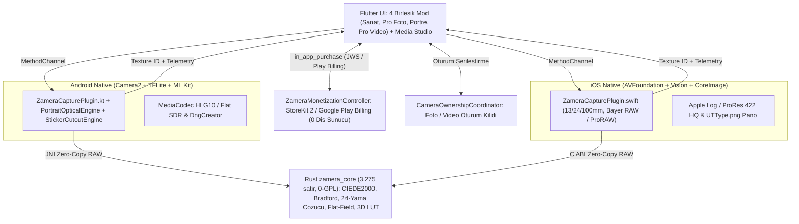

# Zamera — Rapor v3: Kapsamlı Kod Tabanı Denetimi, Gerçekleşen Mimari ve Gelir Modeli

> **Tarih:** 16 Kasım 2026 (`v0.1.5+6` sonrası mimari ve ticari güncelleme)
> **Kapsam:** v1 ([ilk rapor](file:///C:/Users/theak/.gemini/antigravity/brain/9d7b95f2-176e-444e-81e6-0a0e4a4da58e/zamera_arastirma_ve_mimari_raporu.md)) ve v2 (06.11.2026 revize tasarım) aşamalarından sonra repoda fiilen inşa edilen **Flutter + Native (Camera2/AVFoundation) + Rust (`zamera_core`)** kod tabanının kapsamlı teknik denetimi, **Zamera Cine ayrıştırmasının iptali** ve **1 Ay Ücretsiz Denemeli Hibrit Freemium Gelir Modeli** kararlarını içerir.

---

## 1. Gerçekleşen Monorepo Mimarisi ve Kod Envanteri

İlk tasarımda öngörülen 4–6 aylık çekirdeğin tamamı `com.akarworks.zamera` altında çalışır duruma getirilmiştir. Kod tabanının doğrulanmış katman envanteri:

| Katman | Konum | Doğrulanmış Kapsam & Sorumluluk |
| :--- | :--- | :--- |
| **Rust Renk Çekirdeği** | [`rust/zamera_core/src/lib.rs`](file:///c:/Users/theak/source/repos/zamera/rust/zamera_core/src/lib.rs) (`3.275` satır, `12` birim test) | Sharma 2005 doğrulanmış **CIEDE2000 (`ΔE₀₀`)**, Bradford D50→D65 kromatik adaptasyon, McCamy CCT / DNG mired interpolasyonu, **24-Yama ColorChecker en küçük kareler $3\times 3$ çözücü**, $8\times 6$ Flat-Field kazanç hesabı, sabit tonlu negatif gamut sıkıştırma, 16-bit Bayer demosaic + homografi perspektif düzeltme, `.cube` 3D LUT trilinear örnekleyici (`CubeLut3D`), 180° enstantane/Auto-ISO matematiği ve ses Peak/RMS dBFS + 6-bant IRE False Color. |
| **Android Native Eklentisi** | [`packages/zamera_capture/android/`](file:///c:/Users/theak/source/repos/zamera/packages/zamera_capture/android/src/main/kotlin/com/akarworks/zamera_capture) | `ZameraCapturePlugin.kt` (`7.122` satır), `PortraitOpticalEngine.kt` (`1.289` satır), `StickerCutoutEngine.kt` (`707` satır), `ZameraMediaFileProvider.kt` (`131` satır). Camera2 donanım/lens probe, 14-bit `RAW_SENSOR` yakalama, TFLite (`depth_anything_v2_small.tflite` ~27.7 MB, `selfie_multiclass_256x256.tflite` ~16.4 MB, `u2netp.tflite` ~4.6 MB) + ML Kit Subject Segmentation hibrit sticker/portre motoru ve 16 KB page-size hizalı JNI `libzamera_core.so`. |
| **iOS Native Eklentisi** | [`packages/zamera_capture/ios/`](file:///c:/Users/theak/source/repos/zamera/packages/zamera_capture/ios/Classes/ZameraCapturePlugin.swift) | `ZameraCapturePlugin.swift` (`3.742` satır) + `PrivacyInfo.xcprivacy`. AVFoundation fiziksel lens ayrımı (13mm/24mm/100mm), 12MP Bayer RAW vs 48MP ProRAW, Apple Log & ProRes 422 HQ kayıt, Apple Vision özne maskeleme + unpremultiplied RGBA/`UTType.png` şeffaf sticker panoya kopyalama. |
| **Birleşik Pro Video Paketi** | [`packages/zamera_video/lib/zamera_video.dart`](file:///c:/Users/theak/source/repos/zamera/packages/zamera_video/lib/zamera_video.dart) (`912` satır) | `CameraOwnershipCoordinator` ile fotoğraf ve video kamera oturumlarını serileştirir; termal koruma (`ZameraThermalLevel`), 180° shutter kilidi, `.cube` 3D LUT ve platform bazlı profil kayıt tablosu (`Rec.709`, `HLG10`, `Flat SDR`, `Apple Log`, `ProRes 422 HQ`) sunar. **16.11.2026 itibarıyla *Zamera Cine* olarak ayrı uygulamaya bölme fikri kalıcı olarak iptal edilmiştir (ADR-5).** |
| **Flutter UI & Stüdyo** | [`app/lib/`](file:///c:/Users/theak/source/repos/zamera/app/lib) | 4 birleşik kamera modu (`SANAT`, `PRO`, `PORTRE`, `VİDEO`), 120 FPS eşmerkezli 3-halkalı (`Ring 0/1/2`) radyal kadran, Bumpless PASM (`P/Tv/Sv/M`), 3x AEB, Tam Ekran **Pro Media & Sticker Stüdyosu** ([media_studio_screen.dart](file:///c:/Users/theak/source/repos/zamera/app/lib/screens/media_studio_screen.dart): 6 filtreli arşiv, `TrueColor ↔ OEM` A/B split perde, CIE `L*a*b*`/`ΔE₀₀` büyüteci, 64-bin RGB histogram, SMPTE video oynatıcı) ve sıfır-telemetri **Zamera Pro** katmanı. |
| **CI/CD & Web/GEO** | [`.github/workflows/`](file:///c:/Users/theak/source/repos/zamera/.github/workflows) & [`docs/`](file:///c:/Users/theak/source/repos/zamera/docs) | GitHub Actions üzerinden Rust `cargo-deny` lisans kapısı + Android AAB/APK (16 KB hizalı) + macOS Xcode/Fastlane TestFlight/App Store Connect otomasyonu ve GitHub Pages gizlilik/destek portalı. |

---

## 2. Gerçekleşen Mimari Diyagramı ve Fiziksel Cihaz Doğrulaması

### Doğrulanmış Fiziksel Cihaz Probe Bulguları — Xiaomi 14 (`houji`)

[`xiaomi_14_23127PN0CG.json`](file:///c:/Users/theak/source/repos/zamera/docs/cihaz_yetenekleri/xiaomi_14_23127PN0CG.json) (Xiaomi `23127PN0CG`, Android 16 / SDK 36, `zamera_core 0.3.0`) çıktısı v2'deki kritik Xiaomi risklerini saha verisiyle netleştirmiştir:

| Kamera ID | Rol | Donanım & Yetenekler | Doğrulanmış Probe Bulgusu |
| :--- | :--- | :--- | :--- |
| **`0` (Mantıksal Arka)** | Çoklu Kamera | `LEVEL_3`, `LOGICAL_MULTI_CAMERA`, `RAW`, `HLG10` | `RAW_SENSOR 4096×3072`, `6.55mm f/1.6 OIS`, `sensorWhiteLevel: 16383` (14-bit), fiziksel alt ID'ler: `["2", "3"]`. |
| **`2` (Fiziksel Ana)** | 23mm Ana Lens | `LEVEL_3`, `RAW_SENSOR 4096×3072`, `HLG10` | `cameraIdList` içinde `isDirectlyOpenableInCameraIdList: false` raporlansa da `6.55mm f/1.6`, ISO `50..3188`, `OIS` ve `14-bit` RAW yetenekleri doğrulanmıştır. |
| **`3` (Fiziksel Ultra Geniş)** | 14mm UW | `LEVEL_3`, `RAW_SENSOR 4080×3072`, `HLG10` | `2.16mm f/2.2`, `10-bit` (`sensorWhiteLevel: 1023`), `supportsOis: false`, ISO `50..3200`. |
| **`1` (Ön Kamera)** | Selfie | `LEVEL_3`, `RAW_SENSOR 3264×2448`, `HLG10` | `2.83mm f/2.0`, `sensorWhiteLevel: 1023`, ön kamera ayna dokunuş düzeltmesi v0.1.5+6 ile giderildi. |
| **50MP Tam Çözünürlük** | `ULTRA_HIGH_RES` | `maxResolutionRawSensorSizes: []` | Bu HyperOS derlemesinde 3. parti Camera2 akışına 50MP tam piksel RAW açılmamıştır; 12.6MP `4096×3072` RAW güvenilir standarttır. |

> [!NOTE]
> iOS tarafı için [`iphone_pro_probe.json`](file:///c:/Users/theak/source/repos/zamera/docs/cihaz_yetenekleri/README.md) saha dökümü henüz fiziksel cihazdan eklenmemiştir; iOS derleme ve TestFlight hattı GitHub Actions `macos-latest` üzerinde aktiftir.

---

## 3. Kapsamlı Teknik Denetim: Güçlü Yönler ve İyileştirme Alanları

### Güçlü Yönler (Üretim Hazırlığı)
1. **Sıfır-GPL ve Sıfır-Telemetri Disiplini:** [`deny.toml`](file:///c:/Users/theak/source/repos/zamera/rust/zamera_core/deny.toml) yalnızca ticari mağaza uyumlu lisanslara (`MIT`, `Apache-2.0`, `BSD`, `ISC`, `Zlib`, `CC0`) izin verir. [`PrivacyInfo.xcprivacy`](file:///c:/Users/theak/source/repos/zamera/packages/zamera_capture/ios/zamera_capture/Sources/zamera_capture/PrivacyInfo.xcprivacy) sıfır veri toplama beyanını korur; tüm renk/AI/sticker motorları cihaz içinde çalışır.
2. **Bellek & IPC Güvenliği:** `MediaStudioScreen` RGBA decode önbelleğini `_maxDecodedCacheEntries = 4` ile LRU olarak sınırlar; `camera_home_screen.dart` ise 120 FPS radyal kadran hareketlerinin MethodChannel'ı tıkamaması için `_isPushingControls` / `_pendingControlsPush` koales mekanizması kullanır.
3. **16 KB Page-Size & Donanım Uyumluluğu:** Android NDK Rust derlemesi `-Wl,-z,max-page-size=16384` bayrağıyla Google Play Android 15/16 zorunluluğunu karşılar.
4. **Sözleşme Testi Kapsamı:** Flutter/Dart katmanında renk bilimi (`Sharma 2005`), PASM pozlama durakları, radial ring geometrisi, Media Studio arşivi, 3D LUT/180° sinema matematiği ve gelir/kota akışları birim ve widget testleriyle kapsanmıştır.

### Teknik Borç ve Sonraki Mühendislik Adımları
1. **Büyük Dosya Bölünmesi (SRP):** [`camera_home_screen.dart`](file:///c:/Users/theak/source/repos/zamera/app/lib/screens/camera_home_screen.dart) (`~5.700` satır), [`ZameraCapturePlugin.kt`](file:///c:/Users/theak/source/repos/zamera/packages/zamera_capture/android/src/main/kotlin/com/akarworks/zamera_capture/ZameraCapturePlugin.kt) (`7.122` satır) ve [`ZameraCapturePlugin.swift`](file:///c:/Users/theak/source/repos/zamera/packages/zamera_capture/ios/Classes/ZameraCapturePlugin.swift) (`3.742` satır) çok büyük hale gelmiştir. Sonraki refactor sprint'inde kamera oturumu, video kayıt, sticker/portre köprüsü ve HUD durumları ayrı denetleyici sınıflara ayrılmalıdır.
2. **Fiziksel iPhone Saha Doğrulaması:** Bir iPhone Pro cihazından `Zamera Probe` JSON dökümü alınıp `docs/cihaz_yetenekleri/iphone_pro_probe.json` olarak arşivlenmeli; Apple Log ve ProRes 422 HQ harici SSD akışı saha testiyle doğrulanmalıdır.
3. **Uzun Kayıt & Depolama Koruması:** 4K ProRes 422 HQ ve yüksek bitrate HLG10 çekimlerinde kayıt başlatılmadan önce cihaz boş disk alanı eşiği kontrol edilmelidir.

---

## 4. Onaylanan Gelir Modeli ve Fiyatlandırma Stratejisi (ADR-6)

### Neden "Aha-Öncelikli Hibrit Freemium + 1 Ay Ücretsiz Deneme"?
1. **Sunucu Maliyeti `$0`:** Rust renk bilimi, TFLite/ML Kit/Apple Vision sticker ve portre işleme %100 cihaz üzerinde koşar. GPU/bulut faturası olmadığı için **Ömür Boyu (Lifetime)** seçeneği %85 net mağaza marjıyla sürdürülebilirdir ve kamera kategorisindeki *abonelik yorgunluğunu* kazanca dönüştürür.
2. **Reklam (AdMob) Yasağı:** Zamera'nın en büyük rekabet avantajı *"%100 Çevrimdışı & Sıfır İzleyici"* güvenidir; reklam SDK'sı App Store gizlilik rozetini bozar.
3. **Peşin Ücretli İndirme Riski:** Android cihazlarda üretici Camera2 kısıtları nedeniyle peşin ücretli uygulama 1★ iade riskini artırır. Ücretsiz Faz 0 Probe ve temel çekim bu riski sıfırlar.
4. **Sıfır-Telemetri Ödeme Mimarisi:** RevenueCat/Adapty gibi 3. parti gelir SDK'ları yerine doğrudan [`in_app_purchase`](file:///c:/Users/theak/source/repos/zamera/app/lib/services/zamera_monetization_gateway.dart) üzerinden Apple **StoreKit 2** ve **Google Play Billing** kullanılır; harici analitik sunucusuna hiçbir veri gitmez.

### Katman & Günlük "Aha-Anı" Kota Matrisi

| Özellik / Mod | Ücretsiz Katman | Zamera Pro (veya Aktif 1 Ay Deneme) |
| :--- | :--- | :--- |
| **Faz 0 Donanım & Lens Probe** | Sınırsız ücretsiz | Sınırsız |
| **Standart Pro Foto & Portre** | `JPEG`, `HEIF 10B`, PASM, 3x AEB, Portre modu sınırsız | Sınırsız |
| **Standart Pro Video (`Rec.709`)** | 4K/1080p, 180° shutter kilidi ve Rack Focus sınırsız | Sınırsız |
| **Sanat Modu Canlı Önizleme & A/B Perde** | Canlı spot renk ölçer & `TrueColor ↔ OEM` inceleme ücretsiz | Sınırsız |
| **TrueColor 1:1 Sanat Çekimi** | Günde **1 ücretsiz** tam kalibreli çekim | **Sınırsız** |
| **14-Bit DNG RAW / 48MP ProRAW** | Günde **1 ücretsiz** RAW çekim veya DNG paylaşım | **Sınırsız** |
| **Şeffaf PNG Sticker Kesimi & Rafı** | Önizleme ücretsiz; günde **3 ücretsiz** dışa aktarım (kopyala/paylaş/kaydet) | **Sınırsız** |
| **24-Yama ColorChecker Sensör Kalibrasyonu** | Paywall (`ZameraProFeature.colorCheckerCalibration`) | **Açık** |
| **Kayıpsız 1:1 PNG Arşivi** | Paywall (`ZameraProFeature.losslessPngArchive`) | **Açık** |
| **10-Bit Sinema (`HLG10`/`Apple Log`/`ProRes`) & Özel `.cube` LUT** | Paywall (`ZameraProFeature.cinemaTenBitLogProRes`) | **Açık** |

### Önerilen Fiyatlandırma Tablosu (`ZameraPlanId`)

| Plan (`productId`) | Küresel (USD) | Türkiye (PPP) | Rolü ve Deneme Koşulu |
| :--- | :--- | :--- | :--- |
| **Yıllık Pro** *(Varsayılan Seçili)* (`com.akarworks.zamera.pro.annual`) | **\$19.99 / yıl** | **₺449,99 / yıl** | **30 Gün (1 Ay) Ücretsiz Deneme**; ana tekrarlayan gelir (MRR/ARR) motoru. |
| **Ömür Boyu Pro** (`com.akarworks.zamera.pro.lifetime`) | **\$34.99** *(Normal: \$49.99)* | **₺799,99** *(Normal: ₺1.199,99)* | Lansman indirimiyle abonelik karşıtı kullanıcıları yüksek peşin nakde dönüştürür. |
| **Aylık Pro** (`com.akarworks.zamera.pro.monthly`) | **\$3.99 / ay** | **₺99,99 / ay** | Kısa dönem/sergi projeleri için giriş ve yıllık plan fiyat çıpası. |

### Faz 2 Ek Gelir Kaldıraçları (Fiziksel Renk Referans Kartı)
1. **Satış Ortaklığı (Affiliate — Sıfır Stok Maliyeti):** Kalibrasyon ekranında fiziksel 24-yama ColorChecker kartı olmayan sanatçılar için güvenilir perakendeciye (Amazon/Trendyol vb.) affiliate linki ile yönlendirme ve komisyon geliri.
2. **"Zamera Cep Renk Kartı + 1 Yıl Zamera Pro QR" Kiti (Orta Vade):** Yüksek marjlı fiziksel kalibrasyon kartı ve abonelik aktivasyon QR paketiyle yazılım dışı savunulabilir gelir hendeği oluşturma.

---

## 5. Kapanan Karar Noktaları Özeti

- **`ADR-1` (CI/CD):** Windows geliştirme ortamına rağmen Android ve iOS derleme/yayın hatları GitHub Actions üzerinde kuruldu (`android-release.yml`, `ios-release.yml`).
- **`ADR-2` (Lisans):** `cargo-deny` ile GPL/AGPL bağımlılıklar kesin yasaklandı; `in_app_purchase` (BSD-3-Clause) eklendi.
- **`ADR-3` (Çekirdek):** Renk bilimi saf Rust (`zamera_core`) ile iki platformda bit-düzeyinde eşitlendi.
- **`ADR-4` (Hedefler):** `com.akarworks.zamera` (iOS 17.0+, Android minSdk 29 / targetSdk 36 / 16 KB hizalı).
- **`ADR-5` (Birleşik Sinema):** *Zamera Cine* ayrıştırması **iptal edildi**; 4 mod tek uygulamada birleşik ve oturum-izole çalışır.
- **`ADR-6` (Gelir Modeli):** **1 Ay (30 Gün) Ücretsiz Denemeli** Aha-Öncelikli Hibrit Freemium + Lifetime Pro, sıfır-telemetri StoreKit 2 / Google Play Billing doğrulamasıyla entegre edildi.
