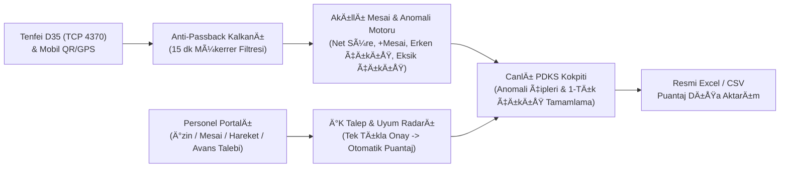

# Hasibu NotebookLM Plus Derin Hafıza & Mimari Atlası

# Hasibu — Sıcak Proje Hafızası (`.agent/PROJECT_MEMORY.md`)
> **Son Güncelleme:** 2026-10-21 | **Mimari:** Antigravity 2.0 (6-Sensei v3.0) | **Durum Yönetimi:** Riverpod 2.6 (`StateNotifierProvider`)

## 1. Riverpod Provider & Notifier Ä°ndeksi (Tahmin Etme, Buradan Oku!)
- **`hasibuDatabaseProvider`** (`Provider<HasibuDatabase>`): [pdks_providers.dart](file:///c:/Users/theak/source/repos/hasibu/lib/features/pdks/presentation/providers/pdks_providers.dart#L13-L17) — SQLite (`sqlite3`) veritabanı tekil örneği.
- **`googleDriveSyncServiceProvider`** (`Provider<GoogleDriveSyncService>`): [pdks_providers.dart](file:///c:/Users/theak/source/repos/hasibu/lib/features/pdks/presentation/providers/pdks_providers.dart#L19-L22) — Gmail & Google Drive JSON anlık görüntü senkronizasyonu.
- **`pdksDashboardProvider`** (`StateNotifierProvider<PdksDashboardNotifier, PdksDashboardState>`): [pdks_providers.dart](file:///c:/Users/theak/source/repos/hasibu/lib/features/pdks/presentation/providers/pdks_providers.dart#L1463-L1468) — Ana PDKS, İK, Özlük, Terminal, İzin ve Talep durumu (`dailyStatuses`, `allLeaveRecords`, `allPersonnelDocuments`, `allHrRequests`, `selectedAnomalyFilter`, `pendingHrRequestsCount`, `statutoryLeaveMismatchCount`).
- **`mobileUiProvider`** (`StateNotifierProvider<MobileUiNotifier, MobileUiState>`): [mobil_arayuz_iyilestirme_provider.dart](file:///c:/Users/theak/source/repos/hasibu/lib/providers/mobil_arayuz_iyilestirme_provider.dart) — Mobil görünüm yoğunluğu (`comfortable`/`compact`), hızlı filtre ve arama durumu.

## 2. SQLite Tabloları (`HasibuDatabase`)
- Dosya: [hasibu_database.dart](file:///c:/Users/theak/source/repos/hasibu/lib/core/database/hasibu_database.dart)
- Tablolar:
  1. `company_settings`: Şirket adı, logo yolu (`logoPath`), otomatik tarama (`autoPollEnabled`, `autoPollMinutes`), yönetici teması (`adminThemeMode`).
  2. `branches`: Şubeler (`id`, `name`, `terminalIp`, `terminalPort`, `latitude`, `longitude`, `geofenceRadiusMeters`, `qrSecret`).
  3. `shifts`: Vardiya planları (`id`, `name`, `startTime`, `endTime`, `toleranceMinutes`, `plannedDurationMinutes`).
  4. `departments`: 27 üretim/şube bölümü (`id`, `name`, `defaultShiftId`).
  5. `employees`: Personel sicil/kart (`id`, `cardNo`, `fullName`, `departmentId`, `branchId`, `shiftId`, `hireDate`, `annualLeaveEntitlement`, `annualLeaveUsed`, `password`, `allowedModules`, `photoPath`, `themeMode`).
  6. `attendance_logs`: Giriş/çıkış hareketleri (`id`, `cardNo`, `branchId`, `deviceNo`, `timestamp`, `isCheckIn`, `source`, `verifyMethod`, `latitude`, `longitude`, `note`).
  7. `leave_records`: İzin ve rapor kayıtları (`id`, `employeeId`, `date`, `leaveType`, `note`).
  8. `personnel_documents`: Dijital özlük dosyası evrakları (`id`, `employeeId`, `category`, `title`, `filePath`, `uploadDate`, `expiryDate`, `notes`).
  9. `hr_requests`: Çift yönlü İK talepleri (`id`, `employeeId`, `employeeCardNo`, `employeeName`, `type`, `status`, `targetDate`, `endDate`, `requestedTime`, `isCheckInCorrection`, `leaveType`, `overtimeMinutes`, `advanceAmount`, `reason`, `reviewerNote`, `createdAt`).

## 3. Donanım & İş Mantığı Sabitleri (`cezeri-piri`)
- **Tenfei D35 Yüz Tanıma Terminali:** [tenfei_zk_client.dart](file:///c:/Users/theak/source/repos/hasibu/lib/features/pdks/data/tenfei_zk_client.dart) — Merkez IP: `192.168.9.150`, Port: `4370` (ZKTeco Binary TCP).
  - `CMD_CONNECT` (`1000`) -> `CMD_ACK_UNAUTH` (`2005`) dönerse `makeCommKey(0, sessionId)` ile `CMD_AUTH` (`1102`) gönderilir.
  - `CMD_ATTLOG_RRQ` (`13`) yanıtında 4-bayt iç tablo uzunluk başlığı + 40-baytlık binary kayıtlar gelir; aynı gün 2. okuma çıkış (`isCheckIn: false`) olarak sınıflandırılır.
- **Anti-Passback Debounce:** [`_evaluateDayLogs`](file:///c:/Users/theak/source/repos/hasibu/lib/features/pdks/presentation/providers/pdks_providers.dart#L789-L896) içinde ilk girişten sonraki **15 dakika** içinde yapılan mükerrer okumalar filtrelenir (`duplicateScansFiltered`).
- **4857 Sayılı İş Kanunu Md. 53 Kıdem İzin Hesabı:** [`Employee.statutoryAnnualLeaveEntitlement`](file:///c:/Users/theak/source/repos/hasibu/lib/features/pdks/domain/pdks_models.dart#L368-L379) — 1–5 yıl: `14 gün`, 5–15 yıl: `20 gün`, 15+ yıl: `26 gün`.

## 4. Dosya Haritası
- **Domain Modelleri:** [pdks_models.dart](file:///c:/Users/theak/source/repos/hasibu/lib/features/pdks/domain/pdks_models.dart)
- **Başlangıç Verileri (Seed):** [workplace_seed_data.dart](file:///c:/Users/theak/source/repos/hasibu/lib/features/pdks/data/workplace_seed_data.dart) (Örnek siciller: `00064` Mehmet Sinan Cenan, `01406` Abdullah Yıldız, `01110` Müslüm Öncel, `00046` Suliman Alhussin, `00058` Serkan Akbaş)
- **Ana Kabuk & PDKS/İK Ekranları:** [hasibu_shell_screen.dart](file:///c:/Users/theak/source/repos/hasibu/lib/features/pdks/presentation/screens/hasibu_shell_screen.dart) (6 PDKS sekmesi; mobil `NavigationBar` `tabs.take(5)` ile sınırlıdır)
- **Ayarlar & İK Talep/Uyum Radarı:** [hasibu_settings_view.dart](file:///c:/Users/theak/source/repos/hasibu/lib/features/pdks/presentation/screens/hasibu_settings_view.dart) (`HrRequestsAndComplianceView`)
- **Mobil Saha Ekranı:** [mobil_arayuz_iyilestirme_screen.dart](file:///c:/Users/theak/source/repos/hasibu/lib/screens/mobil_arayuz_iyilestirme_screen.dart)
- **Test Paketi:** [widget_test.dart](file:///c:/Users/theak/source/repos/hasibu/test/widget_test.dart) (10 deterministik test)

---

# 🦅 Hezarfen Ahmed Çelebi — Hasibu PDKS & İK Piyasa Analizi ve Mavi Okyanus Stratejisi

> [!IMPORTANT]
> **Sıfır Dalkavukluk & Kesin Objektiflik Doktrini:** Bu rapor, Türkiye'deki gerçek PDKS ve İK rakiplerinin (Perkotek, Meyer, Kolay İK, İdenfit, ZKTeco BioTime) saha gerçeklerini, Şikayetvar ve uygulama mağazalarındaki 1-yıldız kullanıcı acı noktalarını ve Hasibu'nun mevcut `PDKS & İK` modülündeki eksiklikleri tüm çıplaklığıyla ortaya koymak üzere hazırlanmıştır.

---

## 1. Türkiye PDKS & İK Pazarı: Rakip Analizi ve 1-Yıldız Kullanıcı Acı Noktaları (`Hezarfen-Radar`)

| Rakip Platform | Pazar Konumu | Güçlü Yönleri | 1-Yıldız Şikayetler & Kronik Saha Sorunları (Şikayetvar / Mağaza Yorumları) |
| :--- | :--- | :--- | :--- |
| **Perkotek PDKS** | Geleneksel Donanım + Masaüstü PDKS | ZKTeco/Tenfei cihaz yaygınlığı, fabrika ve turnike entegrasyonu | • **Mükerrer Okuma Kaosu:** Personel cihaz önünde 1-2 dk içinde 2 kez yüz okutunca 2. okumayı "Çıkış" sayıp akşamki gerçek çıkışı yutması. • **Destek & Lisans Maliyeti:** Basit puantaj desteği veya format değişikliği için yüksek servis ücreti talep edilmesi. • **Hantal Arayüz:** 2000'lerden kalma karmaşık masaüstü tabloları, tek ekranda eksik çıkış/anomali görülememesi. |
| **Meyer (Angel / Web PDKS)** | Kurumsal Holding & Fabrika PDKS | Gelişmiş vardiya, gece mesaisi ve hakediş kuralları | • **Yüksek Karmaşıklık (UX Muda):** İK uzmanının "Bugün kim erken çıktı, kim çıkış basmayı unuttu?" sorusuna cevap bulmak için 5 farklı rapor ekranı gezmesi. • **ERP/Excel Aktarım Sürtünmesi:** Standart muhasebe/bordro çıktıları için ek entegrasyon maliyeti. |
| **Kolay İK** | Bulut (SaaS) İK & Personel Öz-Servis | Modern arayüz, personel izin/fazla mesai/avans talep-onay akışı, 4857 kıdem hesabı | • **Zayıf Donanım Köprüsü:** Yerel ağdaki yüz tanıma terminaliyle (TCP 4370) doğrudan sıfır-ek-donanım konuşamaması. • **İnternet Bağımlılığı:** Bulut çöktüğünde veya fabrika interneti kesildiğinde yerel veriye erişilememesi. |
| **İdenfit** | Bulut İK & Mobil GPS/QR PDKS | Saha personeli takibi, görev ve vardiya planlama | • **Mobil GPS & Batarya Sorunları:** Telefon güç tasarrufu modlarında konum sapması. • **Kişi Başı Aylık SaaS Maliyeti:** 50+ personelli üretim işletmelerinde her ay artan döviz/TL abonelik yükü. |
| **ZKTeco BioTime 8.0** | Global Biyometrik Cihaz Yazılımı | Doğrudan TCP/Push cihaz yönetimi ve gerçek zamanlı log çekimi | • **Türkiye İş Hukuku (4857) Uyumsuzluğu:** Kıdeme göre yıllık izin hakedişi, resmi özlük dosyası takibi ve Türkçe yalın ön muhasebe puantajının bulunmaması. |

---

## 2. Acımasız Öz-Eleştiri: Hasibu PDKS & İK Modülümüzün Mevcut Eksikleri (`Hezarfen-Sentez`)

Yüz okuma terminalinden (`Tenfei D35 - TCP 4370`) veri çekme ve Google Drive senkronizasyon altyapımız rakiplerden çok daha çevik olsa da, mevcut `HasibuModule.pdksHr` katmanımızda şu **5 kritik eksiklik** bulunmaktaydı:

1. **Sadece "Giriş" Odaklı Eksik Mesai Motoru:**
   - Mevcut yapı yalnızca `firstCheckIn` ve `lateMinutes` (geç kalma) hesaplıyordu.
   - Personelin **Net Çalışma Süresi (`workedMinutes`)**, **Fazla Mesaisi (`overtimeMinutes`)**, **Erken Çıkışı (`earlyLeaveMinutes`)** ve en önemlisi **Çıkış Basmayı Unutma (`hasMissingCheckOut` - Eksik Hareket Anomalisi)** durumu hesaplanmıyordu.
2. **Mükerrer Okuma Kalkanı (Anti-Passback / Debounce) Yokluğu:**
   - Cihaz önünde emin olamayıp 2 dakika arayla iki kez yüz okutan personelin ikinci okuması doğrudan "Çıkış" sanılıp personeli 2 dakika çalışmış gösterme riski taşıyordu.
3. **Personel Öz-Servis İle İK Arasında Kopukluk (Talep & Onay Akışı Yok):**
   - `Personel Portalı` yalnızca bilgi gösteriyordu; personel izin, unutulan giriş/çıkış düzeltmesi, fazla mesai onayı veya avans talebi oluşturamıyor, İK tek tıkla onaylayıp puantaja otomatik işleyemiyordu.
4. **4857 Sayılı İş Kanunu Kıdem & İzin Otomasyonu Eksikliği:**
   - Personelin işe giriş tarihinden (`hireDate`) kıdem yılı ve 4857 Md. 53 yasal yıllık izin hakedişi (1–5 yıl: 14 gün, 5–15 yıl: 20 gün, 15+ yıl: 26 gün) otomatik denetlenmiyordu.
5. **Anomali Filtreleri ve Tek Tıkla Resmi Excel/CSV Puantaj Çıktısı Yokluğu:**
   - Canlı PDKS ekranında "Sadece Fazla Mesai Yapanlar", "Sadece Eksik Çıkışı Olanlar", "Eksik Özlük Evrakı Olanlar" filtreleri ve tek tıkla muhasebeye gönderilecek UTF-8 CSV/Excel puantaj dışa aktarımı yoktu.

---

## 3. Mavi Okyanus (Blue Ocean) Mimari Dönüşüm Planı (`Kanuni's Edict`)

### Devreye Alınan 5 Rekabetçi Üstünlük:
1. **15 Dakika Anti-Passback (Mükerrer Okuma) Kalkanı & Tam Mesai Analitiği:** Ardışık mükerrer okumaları süzer; gece vardiyaları dahil net çalışma, fazla mesai, erken çıkış ve eksik çıkış anomalisini anlık hesaplar.
2. **Canlı PDKS Üzerinde Anomali Filtreleri & 1-Tıkla Eksik Çıkış Tamamlama:** Yöneticinin eksik çıkış basan personeli tek tıkla vardiya bitiş saatine göre tamamlamasını sağlar.
3. **Çift Yönlü İK Talep & Onay Merkezi (`HrRequest`):** Personel Portalı'ndan açılan İzin, Fazla Mesai, Unutulan Giriş/Çıkış ve Avans talepleri SQLite + Google Drive ile senkronize edilir; İK onayladığı anda puantaja veya izin tablosuna otomatik işlenir.
4. **4857 İş Kanunu Kıdem & Özlük Uyum Radarı:** Kıdem yılına göre yasal yıllık izin hakedişlerini hesaplar, tek tıkla eşitler ve eksik zorunlu özlük evraklarını raporlar.
5. **Tek Tıkla Resmi Puantaj Cetveli (CSV / Excel) Dışa Aktarımı:** Ek lisans ücreti olmadan günlük/aylık puantaj tablosunu panoya veya dosyaya aktarır.

